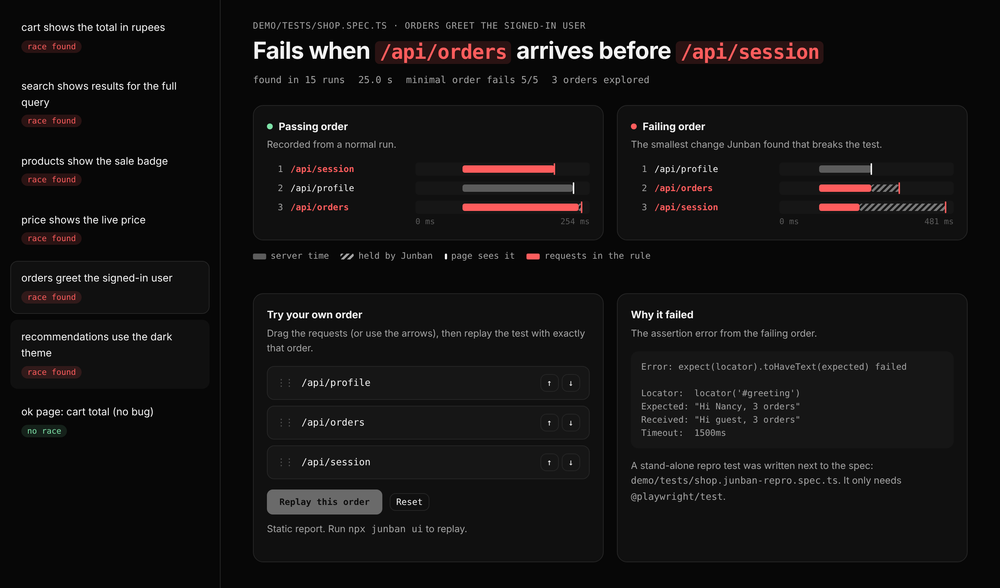

# Junban 順番

[](https://github.com/nancy6547/junban/actions/workflows/test.yml)

**Find the network response order that breaks a flaky Playwright test, and get a repro that fails every time.**

A test that fails 1 run in 300 is the worst kind of bug. You can't debug what you can't reproduce, so the usual fix is "rerun it until it fails" and hope you catch it with the trace on.

Junban takes the luck out. It holds every `fetch`/XHR response in the browser (Chrome DevTools Protocol `Fetch` domain) and releases them in orders *it* chooses. When an order breaks the test, it shrinks it down to one sentence:

```
● orders greet the signed-in user
  RACE FOUND fails when /api/orders arrives before /api/session
  first failure on run 5; minimal order fails 5/5
repro test (needs only @playwright/test): demo/tests/shop.junban-repro.spec.ts
```

…and writes a normal Playwright test that forces that order with `page.route()`, so it fails **every time**, on any machine, without Junban installed. That's a bug report a developer can actually fix.



## Results

Measured on the demo shop: 6 planted races (the kinds that happen in real apps) plus 1 bug-free page as a control. Every number below comes from the scripts in [`bench/`](bench) (rerun them with `RARE=1 npx tsx demo/server.ts` in one terminal and `sh bench/rare.sh` in another). Machine: a 2-core Linux container, Chromium 141, Playwright 1.64.

### Rare races: the flakes that actually hurt

With `RARE=1` the demo's latencies barely overlap, so each race shows up only a few times in a thousand runs. Plain reruns stop at the first failure (`--repeat-each 500 --max-failures 1`, 4 workers).

| Planted race | Plain reruns | Junban: first failing run | Junban: rule found |
|---|---|---|---|
| cart renders before the user's currency loads | not caught in 500 runs (8.4 min) | **run 4** | `/api/cart` before `/api/user` |
| stale search answer overwrites the newer one | not caught in 500 runs (8.6 min) | **run 4** | `?q=ab` before `?q=a` |
| products render before feature flags | caught on run 491 (8.1 min) | **run 4** | `/api/products` before `/api/flags` |
| old price overwrites the live price | not caught in 500 runs (8.3 min) | **run 4** | `/api/price/live` before `/api/price` |
| orders render before session/profile | caught on run 87 (1.5 min) | **run 5** | `/api/orders` before `/api/profile` |
| recs render before the theme (dependent request) | not caught in 500 runs (8.4 min) | **run 5** | `/api/recs` before `/api/theme` |
| bug-free page (control) | n/a | no race reported | n/a |

**Plain reruns caught 2 of 6 races in 3,000 runs (about 43 minutes). Junban caught all 6, each by its 5th run, in 2.1 minutes total** (including shrinking each one to a single rule and confirming it), with no false alarm on the bug-free page.

### Repro tests fail every time

Each generated repro test, run 20 times: **20/20 failures for all 6 races**, and 0/20 for the bug-free test, which the repro leaves alone. A flake that showed up a few times in a thousand runs becomes a test that fails on every run.

### Common races

With the default latencies (each race shows up every 5 to 50 runs), plain reruns did catch all 6, after 5, 7, 16, 17, 21 and 50 runs. Junban needed 4 or 5 runs every time, and the difference is what you get afterwards: one sentence naming the two requests, plus a test that fails every time instead of 1 run in 20.

## Quick start

```bash
npm i -D github:nancy6547/junban
```

Change one import in the spec you want to check. Nothing else changes, and with no Junban run active the fixture does nothing:

```diff
- import { test, expect } from "@playwright/test";
+ import { test, expect } from "junban";
```

Then hunt:

```bash
npx junban hunt tests/checkout.spec.ts                 # every test in the file
npx junban hunt tests/checkout.spec.ts -g "pays once"  # one test
npx junban ui                                          # report with drag-to-replay
```

Options: `--budget 60` (max orders to try), `--workers 4`, `--seed 1` (random orders are repeatable).

**Try it on the demo shop** (6 planted races + 1 bug-free page):

```bash
git clone https://github.com/nancy6547/junban && cd junban
npm install && npx playwright install chromium
npx tsx src/cli.ts hunt demo/tests/shop.spec.ts
npx tsx src/cli.ts ui
```

## How it works

```
 1. record    run the test normally (3x), keep the order responses arrived in a passing run
                 /api/session → /api/profile → /api/orders
 2. explore   hold responses and release them in new orders:
              every "move one response earlier" swap first (n(n-1)/2 orders),
              then seeded random orders, up to the budget
 3. shrink    the failing order flips several pairs; delta debugging (ddmin)
              finds the smallest set of flips that still fails
                 /api/orders before /api/session
 4. confirm   rerun that order 5x; it must fail every time
 5. repro     write <spec>.junban-repro.spec.ts that forces it with page.route()
```

**Why pair swaps first.** 10 requests have 3.6 million orders, but most real races are between *two* requests. Trying every pair first costs only 45 runs and usually finds it. This is the same idea as PCT (Probabilistic Concurrency Testing, Microsoft Research): bugs usually need only a few ordering decisions to go wrong.

**Many orders, one Playwright process.** Junban writes the list of orders to a plan file and runs `playwright test --repeat-each N`. Run *i* reads order *i* (`testInfo.repeatEachIndex`), so a whole batch runs in parallel across workers instead of booting Playwright per order.

**The controller** (`src/controller.ts`):

- `Network.requestWillBeSent` names each request when it's *sent*: `GET /api/search?q=ab#1` (method, path, sorted query without cache-busters, and `#n` for the n-th repeat), so the same request can be matched across runs.
- `Fetch.requestPaused` (response stage) pauses each response when it *arrives*. Junban releases the next one in the order only when the page should see it, with a short gap so the page's JavaScript handles them in that order.
- **Dependent requests.** If the next request in the order hasn't even been sent, the page may be waiting for a response Junban is holding (`/api/recs` is only requested after `/api/session` loads). Instead of deadlocking, Junban lets the least important held response through and checks again.
- A hard cap (4 s) means a held response never hangs a test.

**The repro** uses only Playwright's public API: `route.fetch()` gets the real response, and `route.fulfill()` delivers it once every response it must come after has been delivered.

## Project structure

```
src/
  controller.ts   CDP Fetch + Network: hold and release responses in a chosen order
  fixture.ts      drop-in `test` that runs the controller when Junban is hunting
  runner.ts       run one test under many orders in one Playwright process
  order.ts        pair swaps, seeded shuffles, inversions, ddmin (pure, unit-tested)
  hunt.ts         record → explore → shrink → confirm
  repro.ts        write the stand-alone page.route() repro test
  key.ts          stable request keys across runs
  cli.ts          `junban hunt`, `junban ui`
  ui/             report page + local replay server
demo/             shop with 6 planted races, its Playwright tests
bench/            the benchmark scripts behind the tables above
test/             unit tests (Vitest)
```

## Limitations

- **Only response order.** Junban reorders `fetch`/XHR responses. Races between timers, animations, WebSocket messages or service workers are out of scope.
- **Chromium only**, because it uses the Chrome DevTools Protocol.
- **Requests are matched by method + URL.** Two requests with the same URL are told apart by the order they're sent (`#1`, `#2`). If an app sends identical requests in a random order, keys can swap between runs.
- **The test must notice the bug.** If the page is briefly correct and *then* breaks, an assertion that passes on the first correct frame passes anyway. Two demo tests wait for `networkidle` before asserting for this reason.
- The repro's order is enforced from Node via `page.route()`, which is slower than the controller but uses only public Playwright APIs.

## Related work

- [Replay.io](https://www.replay.io/blog/root-causing-bad-network-requests-in-failed-tests) records a failing run and compares it with a passing one. It explains a failure you already caught; Junban creates the failing order.
- [chaosbringer](https://www.npmjs.com/package/chaosbringer) adds random delays and errors while crawling a site and shrinks the *actions*. It doesn't reorder responses or run your existing tests.
- Research on JavaScript event races (EventRaceCommander, NodeRacer) explores event orders in apps. Junban applies the idea to the Playwright suites teams already have.

Junban is the second tool in a pair: [Zeitaku](https://github.com/nancy6547/zeitaku) replaces fixed sleeps with network-aware waits and tells you which request was in flight when a test failed. Junban tells you which *order* breaks it, and proves it.

---

Built by **Nancy Singh**: [GitHub](https://github.com/nancy6547) · [LinkedIn](https://linkedin.com/in/nancy-singh-84367722a) · [Portfolio](https://nancy6547.github.io)
